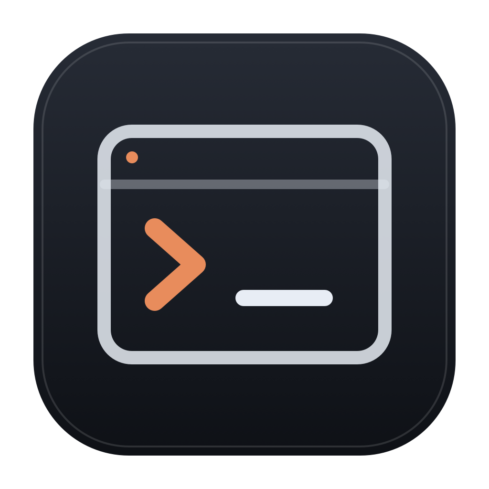

# Пульт + Лимиты для macOS

**Codex и Claude Code в обычном окне Mac: чаты, картинки, история и работа с проектами.** Рядом — отдельное приложение для просмотра лимитов.

<p>
  
  
</p>

Иконки приложений: **Пульт** слева, **Лимиты** справа.

| Приложение | Для чего |
|---|---|
| **Пульт** | Общаться с Codex, Claude Code или подключённым API |
| **Лимиты** | Смотреть лимиты Codex в виджете на рабочем столе и строке меню |

Неофициальный проект. Нужен **Mac с macOS 14 или новее**.


## 1. Скачай приложения

Открой [Releases](https://github.com/abobalover228-afk/pult-public/releases). Если там есть готовая сборка, скачай `Pult-macOS.zip`.

Если сборки в Releases нет:

- Открой [Actions](https://github.com/abobalover228-afk/pult-public/actions), выбери успешный запуск **Build macOS apps** и скачай **Pult-macOS** из раздела **Artifacts**. Для скачивания может понадобиться вход в GitHub. Распакуй архив артефакта, затем находящийся внутри `Pult-macOS.zip`.
- Либо [собери приложения из исходников](#сборка-из-исходников).

Внутри `Pult-macOS.zip` — папка `dist` с двумя приложениями:

```text
dist/
├── Пульт.app
└── Лимиты.app
```

Перенеси **оба приложения рядом**, например в «Программы». Они должны лежать в одной папке, чтобы кнопка открытия Пульта из Лимитов работала.

Готовая сборка рассчитана на архитектуру компьютера сборки. Если она не подходит твоему Mac, собери приложения на нём.

## 2. Подключи помощника

Достаточно одного варианта:

| Хочу использовать | Что потребуется |
|---|---|
| **Codex** | Установленный Codex CLI и вход через `codex login` в Terminal |
| **Claude Code** | Установленный Claude Code и выполненный вход в него |
| **API** | API-ключ, адрес API провайдера и название модели |

Если CLI ещё не установлен, начни с официальной инструкции: [установка Codex CLI](https://learn.chatgpt.com/docs/codex/cli) или [установка Claude Code](https://code.claude.com/docs/en/overview). Terminal можно открыть через Spotlight: нажми **⌘ + пробел**, набери **Terminal** и нажми Enter. После установки войди в выбранный CLI, затем возвращайся в Пульт.

Для CLI-лимитов и управления CLI-аккаунтами нужен **Python 3.10+**. Для API-чата Python и Codex CLI не обязательны.

Пульт ищет CLI в `~/.local/bin`, `/opt/homebrew/bin`, `/usr/local/bin` и `PATH`. При запуске из Finder Python должен быть доступен через стандартные пути Python.org или Homebrew.

## 3. Отправь первую задачу

1. Открой **Пульт.app**.
2. В меню аккаунта выбери Codex, **Claude CLI** или своё API-подключение.
3. Открой настройки **⚙︎**, найди **«Рабочая папка»**, нажми **«…»** и выбери папку проекта.
4. Напиши: **«Посмотри файлы проекта и объясни, как его запустить»**.
5. Отправь сообщение. Этот пример с файлами требует Codex или Claude CLI.

Для обычного API-чата можно начать с **«Привет! Помоги составить план проекта»**.

Чтобы добавить API: меню аккаунта → **«Добавить / изменить API…»** → название, ключ, Base URL, модель → **«Сохранить»** → **«Выбрать»**. Ключ хранится в macOS Keychain. Сохранение и выбор подключения не отправляют запросов. Поддерживается OpenAI-совместимый Chat Completions API; подробности — в [API.md](API.md).

API подходит для чата, изображений, очереди и Суперпромпта. Выполнение команд, MCP и вопросы инструментов требуют CLI. API-запросы оплачиваются по условиям выбранного провайдера; его квота в приложении отмечается как неизвестная.

## 4. Включи Лимиты

Открой **Лимиты.app**: появятся виджет и меню в строке macOS. Время сброса показано в часовом поясе компьютера.

Если аккаунт только что добавлен, нажми **«Обновить список и лимиты»** в Пульте. В Лимитах можно выбрать **«Скрыть в Лимитах»** и затем **«Вернуть скрытые записи»** — аккаунты и данные Пульта от этого не удаляются.

Для Claude приложение читает локальный `~/.claude/limits-cache.json`, если его запись уже настроена. Без кеша квота не появится. Кнопка **«Проверить в Claude Code…»** открывает штатную `/usage`. Перечитывание кеша не делает данные свежими; автоматического получения квоты Claude здесь нет. Подробнее — [CLAUDE-LIMITS.md](CLAUDE-LIMITS.md).

Лимиты Codex читаются через экспериментальный `codex app-server`, поэтому совместимость зависит от версии CLI. Проверка лимитов не запускает задачи модели и не покупает кредиты. Сам чат выполняет реальные задачи и расходует лимиты выбранного аккаунта.

## Если что-то не работает

| Что случилось | Что сделать |
|---|---|
| macOS не разрешает открыть приложение | После попытки запуска открой «Системные настройки → Конфиденциальность и безопасность» и разреши запуск |
| Codex не найден | Проверь в Terminal `codex --version`, затем выполни `codex login` |
| Claude не найден | Проверь в Terminal `claude --version` и вход в Claude Code |
| Лимиты Codex не появились | Проверь `python3 --version`, вход в Codex и нажми обновление |
| Лимиты Claude отсутствуют | Открой штатную `/usage`; виджет сам не получает квоту Claude |
| Пульт не открывается из Лимитов | Положи оба приложения в одну папку |
| Готовая сборка не запускается на этом Mac | Проверь macOS 14+ и собери приложения из исходников под свой Mac |

Приложения имеют локальную ad-hoc подпись без нотариального заверения Apple. Отключать защиту macOS не требуется. Для кнопок входа и открытия CLI macOS может запросить доступ к Terminal.

## Что ещё умеет Пульт

- Потоковые ответы, история диалогов, изображения и выбор модели.
- Несколько своих аккаунтов и переключение между ними.
- Slash-команды, очередь сообщений, вопросы и подтверждения действий.
- Редактирование сообщения с сохранением предыдущей ветки.
- Общие правила и правила отдельного чата, закрепления и `/fast`.
- Автосворачивание служебных блоков и свободная прокрутка во время ответа.
- Свой фон окна.
- **Группа GPT**: распределение задачи, два независимых аналитических ответа и общий результат.

«Группа GPT» делает до четырёх запросов и дополнительно расходует лимиты. Она выполняет только анализ, не редактирует файлы параллельно и не поддерживает Claude CLI. Платный запуск через API подтверждается отдельно. Подробнее — [FEATURES-1.2.md](FEATURES-1.2.md).

## Аккаунты и данные

По умолчанию используется `~/.codex`. Через меню аккаунта в Пульте или окно аккаунтов в Лимитах можно добавить новый аккаунт: откроется официальный вход Codex в Terminal. После входа нажми **«Обновить список и лимиты»**.

Другой способ — создать `~/.codex-accounts.json` по образцу [accounts.example.json](accounts.example.json). Для каждого аккаунта нужны отдельная папка `CODEX_HOME` и отдельный вход. Авторизация и конфигурации основного аккаунта не копируются; CLI и плагины для нового аккаунта может потребоваться настроить отдельно.

Автопереключение может переносить историю диалога между папками выбранных аккаунтов. Используй только свои аккаунты, которым разрешено видеть этот разговор. Отключить автопереключение можно в настройках.

Автоподтверждение действий в публичной версии изначально выключено. По умолчанию используется песочница `workspace-write`: запись разрешена в папке проекта. Эти настройки доступны в интерфейсе Пульта.

Данные приложения, включая фон, вложения и передачу разговора Claude, сохраняются в `~/Library/Application Support/PultPublic`. Приложения используют отдельные от личной установленной версии bundle identifiers.

### Необязательно: VLESS

Если нужен прокси, самостоятельно установи xray в `~/Library/Application Support/PultPublic/bin/xray` и создай файл `~/Library/Application Support/PultPublic/vless.txt` со своей ссылкой. Бинарник и ссылки в комплект не входят. Без них прокси отключён. Настройка находится в разделе **«VLESS только для Пульта»**.

## Сборка из исходников

Нужны macOS 14+ и Xcode Command Line Tools с SDK macOS. Для проверок также нужен Python 3.10+.

Открой Terminal и установи инструменты Apple, если их ещё нет:

```sh
xcode-select --install
```

Дождись окончания установки. Затем скачай проект и собери приложения:

```sh
git clone https://github.com/abobalover228-afk/pult-public.git
cd pult-public
bash build.sh
```

Результат: `dist/Пульт.app`, `dist/Лимиты.app` и `Pult-macOS.zip`.

Сборка создаётся под архитектуру текущего Mac. Загрузка Swift-пакетов не требуется. Скрипт не устанавливает приложения поверх существующих.

Для проверки выполни из той же папки:

```sh
bash check.sh
```

Проверки выполняются офлайн, без запуска задач модели и платных API-запросов.

## Разработка и публикация

[GitHub Actions](https://github.com/abobalover228-afk/pult-public/actions) проверяет и собирает приложения после push и для pull request. Результат появляется в Artifacts успешного запуска; автоматически создавать Release workflow не настроен.

В Git публикуется содержимое этой папки. Готовые `.app`, папки `Apps`, `dist`, `.build` и ZIP не добавляются в репозиторий. Архив приложения можно распространять через [Releases](https://github.com/abobalover228-afk/pult-public/releases) или Actions Artifacts. Инструкция для автора — [GIT.md](GIT.md), результаты проверок — [VERIFICATION.md](VERIFICATION.md).
